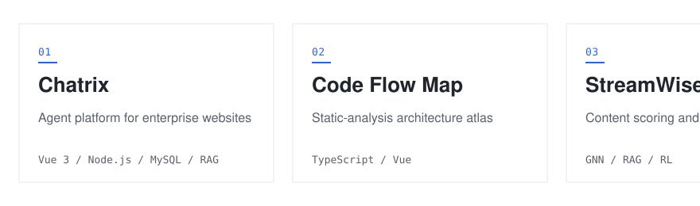

# Soykng

YEKUN SONG · HE/HIM

[Website](https://yekunsong.github.io/) · [LinkedIn](https://www.linkedin.com/in/yekunsong) · [GitHub](https://github.com/yekunsong) · [中文](README.zh.md)

Computer Science and Technology undergraduate working on LLM applications and computer vision.

<picture class="strip"><source media="(prefers-color-scheme: dark)" srcset="assets/projects-dark.svg"></picture>

### Projects

| Period | Project | One line |
| --- | --- | --- |
| `Aug 2026 — present` | [Chatrix](https://www.yanjutech.com/en) | Agent platform for enterprise websites, built end to end |
| `Jun 2026 — Aug 2026` | [Code Flow Map](https://github.com/yekunsong/code-flow-map) | Static-analysis atlas of imports, layers, and data flows |
| `May 2026 — Jul 2026` | StreamWise | Scoring engine, LLM generation, and RL calibration |
| `Sep 2025 — Jan 2026` | Defect Detection | Detection head and segmentation refinement with ablations |
| `Sep 2025 — Jan 2026` | Radiative Cooling | Inverse topology design with NSGA-II and cost-weighted selection |

### Experience

<code>Aug 2026 — present</code> · **AI Agent Development Intern**, Shanghai Xinshutongshi Technology Co., Ltd. (Internship · Shanghai, China)

- Built an end-to-end customer-service agent workflow with traceable stages, checkpoints, and structured evidence across context assembly, tool calls, generation, safety checks, sending, and feedback.
- Integrated observability with quality assurance so every reply can be replayed, audited, and traced to root cause.
- Cut average reply latency from 20 s+ to 12 s while improving quality, and turned human-reviewed failures into regression cases covering original issues, counterexamples, and adjacent scenarios.

<code>May 2026 — Jul 2026</code> · **Technical lead**, StreamWise — technical design and task decomposition across scoring, generation, and RL calibration.

### Education

<code>2023 — 2028</code> · **Xiamen University Malaysia** — Bachelor of Computing and Data Science (Computer Science)

CGPA 3.80 / 4.0 · Dean’s List two consecutive years · multiple university scholarships

### Skills

Methods: `AI agents` `Agent workflow optimization` `RAG` `NLP` `Reinforcement learning` `Graph neural networks` `Mathematical modeling` `Multi-objective optimization` `Data visualization` `Technical documentation`

Tools: `Python` `C++` `Java` `PyTorch` `Vue 3` `Node.js / Express` `MySQL` `Git` `Linux` `LaTeX`

### Honors

- Bronze Award, Southeast Asia Contest of the China International College Students’ Innovation Competition (SEA-CICSIC 2026), Jul 2026 — StreamWise, Technical lead
- Second Prize, 2025 MathorCup Applied Mathematics Challenge — Big Data (Dec 2025)
- First Prize, 2025 Asia-Pacific Mathematical Contest in Modeling (Nov 2025)
