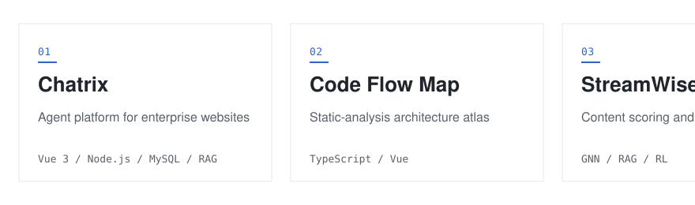

# Soykng

[个人网站](https://yekunsong.github.io/zh/) · [LinkedIn](https://www.linkedin.com/in/yekunsong) · [GitHub](https://github.com/yekunsong) · [EN](README.md)

计算机科学与技术本科在读，主要做大模型应用开发和计算机视觉实验。

<picture class="strip"><source media="(prefers-color-scheme: dark)" srcset="assets/projects-dark.svg"></picture>

### 项目

| 周期 | 项目 | 一句话 |
| --- | --- | --- |
| `2026 年 8 月至今` | [言矩](https://www.yanjutech.com/zh) | 面向企业网站、端到端独立完成的智能体平台 |
| `2026 年 6 月 — 2026 年 8 月` | [Code Flow Map](https://github.com/yekunsong/code-flow-map) | 导入、分层与数据流的静态分析架构图谱 |
| `2026 年 5 月 — 2026 年 7 月` | StreamWise | 评分引擎、大模型生成与强化学习校准 |
| `2025 年 9 月 — 2026 年 1 月` | 工业表面缺陷检测 | 检测头与分割细化，配合消融实验 |
| `2025 年 9 月 — 2026 年 1 月` | 辐射制冷 | 基于 NSGA-II 与成本加权选择的逆向拓扑设计 |

### 数据

<picture class="stat"><source media="(prefers-color-scheme: dark)" srcset="https://github-readme-stats-eight-theta.vercel.app/api?username=yekunsong&show_icons=true&bg_color=00000000&hide_border=true&disable_animations=true&title_color=ff7a5c&icon_color=ff7a5c&text_color=9198a1"></picture> <picture class="stat"><source media="(prefers-color-scheme: dark)" srcset="https://streak-stats.demolab.com?user=yekunsong&background=00000000&hide_border=true&ring=ff7a5c&fire=ff7a5c&currStreakLabel=9198a1&sideLabels=9198a1&dates=9198a1&currStreakNum=9198a1&sideNums=9198a1"></picture>

### 经历

<code>2026 年 8 月至今</code> · **AI Agent 开发实习生**，Shanghai Xinshutongshi Technology Co., Ltd.（实习 · 中国上海）

- 搭建端到端的客服智能体工作流，在上下文组装、工具调用、生成、安全检查、发送与反馈各阶段保留可追踪的环节、检查点和结构化证据。
- 将可观测性与质量保障结合，使每条回复都可回放、审计并追溯到根因。
- 在提升质量的同时，将平均回复延迟从 20 s 以上降到 12 s；并把人工复核发现的失败案例转化为回归用例，覆盖原始问题、反例与相邻场景。

<code>2026 年 5 月 — 2026 年 7 月</code> · **技术负责人**，StreamWise —— 负责评分、生成与强化学习校准的技术设计与任务拆解。

### 教育经历

<code>2023 — 2028</code> · **厦门大学马来西亚分校** — 计算与数据科学学士（计算机科学）

平均绩点 3.80 / 4.0 · 连续两年入选院长荣誉名单 · 多次获得大学奖学金

### 技能与工具

方法：`AI Agent` `智能体工作流优化` `RAG` `NLP` `强化学习` `图神经网络` `数学建模` `多目标优化` `数据可视化` `技术文档`

工具：

<picture class="skill"><source media="(prefers-color-scheme: dark)" srcset="https://skillicons.dev/icons?i=python,typescript,cpp,java,pytorch,vue,nodejs,mysql,linux,git&theme=dark&perline=10"></picture>

### 荣誉

- 东南亚赛区铜奖，中国国际大学生创新大赛东南亚赛区（SEA-CICSIC 2026，2026 年 7 月）—— StreamWise，技术负责人
- 2025 年 MathorCup 应用数学挑战赛大数据赛道二等奖（2025 年 12 月）
- 2025 年亚太地区大学生数学建模竞赛一等奖（2025 年 11 月）
